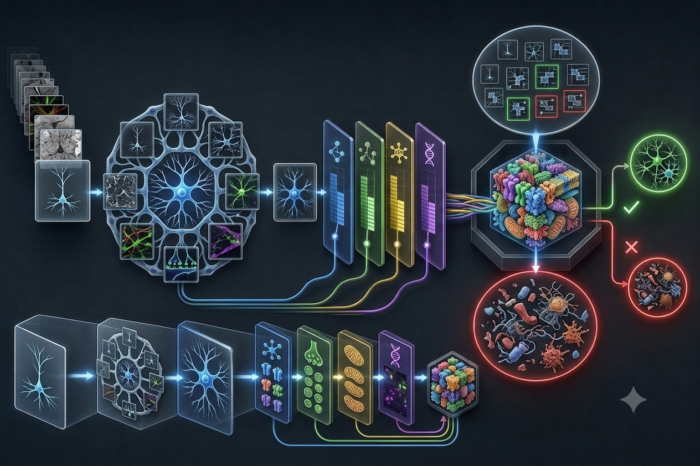

# Plexus



**A symmetry-routed exact classifier — a router, not a network.**

Plexus has no weights, no thresholds, no statistics. It files every binary grid by what its shape **is**, not where it sits:

```
D4 root / D6 root → box → symmetry walk → mass → joins → [extensions] → orientation → pose → corner
```

The bounding box of the non-zero pixels picks the lattice (square, or hex when a square box gains symmetry by shearing its rows). The shape is turned into a canonical pose and walked through one yes/no question per symmetry. Mass and joins follow, then how and where the shape arrived. Two tries, one per lattice, hold the counts; every partial key is a node with its own evidence.

A read answers **POSITIVE**, **NEGATIVE**, **ASSUMED** (a pure node stands in for something never seen, as far as the extrapolation setting allows) or **UNSEEN**. Where different shapes collide, Plexus inserts a shape coordinate on its own; where one shape is labelled differently by pose or place, the trailing levels already separate it. Contradictions are kept exactly, never smoothed over.

The unifying idea is the **slice**: fix some coordinates of the key and enumerate everything that answers so. Classification runs the key forward; a slice runs it backward, and generates the grids it would answer for.

## Quickstart

Requires **Java 21+**. No dependencies — the JDK is the whole toolchain.

```sh
# compile (macOS/Linux)
javac -d out $(find src -name "*.java")
# compile (Windows PowerShell)
javac -d out (Get-ChildItem -Recurse src -Filter *.java).FullName

# train + drop into the REPL
java -cp out org.tervel.plexus.cli.Main data/conservation-t-orbit-3x3.txt
```

```
[5] score  [t] trie  [4] grid  [s] slice  [8] diagnose  [q] quit
```

As a library:

```java
final var plexus = new Plexus(3, 3);                 // the input frame
plexus.fit(grids, labels);
final var answer = plexus.read(grid);                // POSITIVE, NEGATIVE, ASSUMED or UNSEEN, with its context
plexus.slice(Slice.on(Root.D4).atLeast("short-axis mirror").label(1),
             (g, context, evidence) -> { ... });     // every matching grid, CONFIRMED or ASSUMED
```

## Sixty seconds of output

**The trie keeps shape and pose apart.** Trained on the eight T's of a 3×3 frame, `[t]` shows them sharing one shape path and splitting only at the trailing levels:

```
D4 root  [neg 0, pos 8]
  box=2x3  [neg 0, pos 8]
    rot180=no  [neg 0, pos 8]
      short-axis mirror=yes  [neg 0, pos 8]
        long-axis mirror=no  [neg 0, pos 8]
          mass=4  [neg 0, pos 8]
            joins=3  [neg 0, pos 8]
              turned=no  [neg 0, pos 4]
              ...
              turned=yes  [neg 0, pos 4]
              ...
```

**You choose how far it extrapolates.** On the same data, `[4]` with the L `xxx/x..` (same box, mass and joins as the T, but no mirror):

```
  RECT on D4, box 2x3, symmetries [], mass 4, joins 3, orientation 0, pose 0, corner (0,0)
  NONE       UNSEEN     D4 box=2x3 → rot180=no  [neg 0, pos 8]
  PLACEMENT  UNSEEN     D4 box=2x3 → rot180=no  [neg 0, pos 8]
  SYMMETRY   ASSUMED  label 1   D4 box=2x3 → rot180=no  [neg 0, pos 8]
  EVERYTHING ASSUMED  label 1   D4 box=2x3 → rot180=no  [neg 0, pos 8]
```

**It grows the coordinate it needs.** On `data/separable-path-fork-5x5.txt` a path and a fork share box, symmetry, mass and joins; `[8]` shows what Plexus inserted:

```
mixed nodes and what resolves them
  D4 box=2x4 → rot180=no → short-axis mirror=no → long-axis mirror=no → mass=5 → joins=4  [neg 1, pos 1]
    -> several shapes: separated by max-degree
```

The behaviour is asserted, not just printed: the suite checks pose-free keys on every dataset, the stand-ins, extension, and that what a slice generates is exactly what reading answers for.

## Where to read more

- **[docs/](docs/README.md)** — the design as a document set: the descriptor, the trie and the extrapolation setting, self-extension, slices, and the interpreter.
- **[data/README.md](data/README.md)** — the datasets and the question each one asks.
- **[Plexus: Intuitions from a Symmetry Machine](https://noxidog.substack.com/p/plexus)** — the companion essay series.
