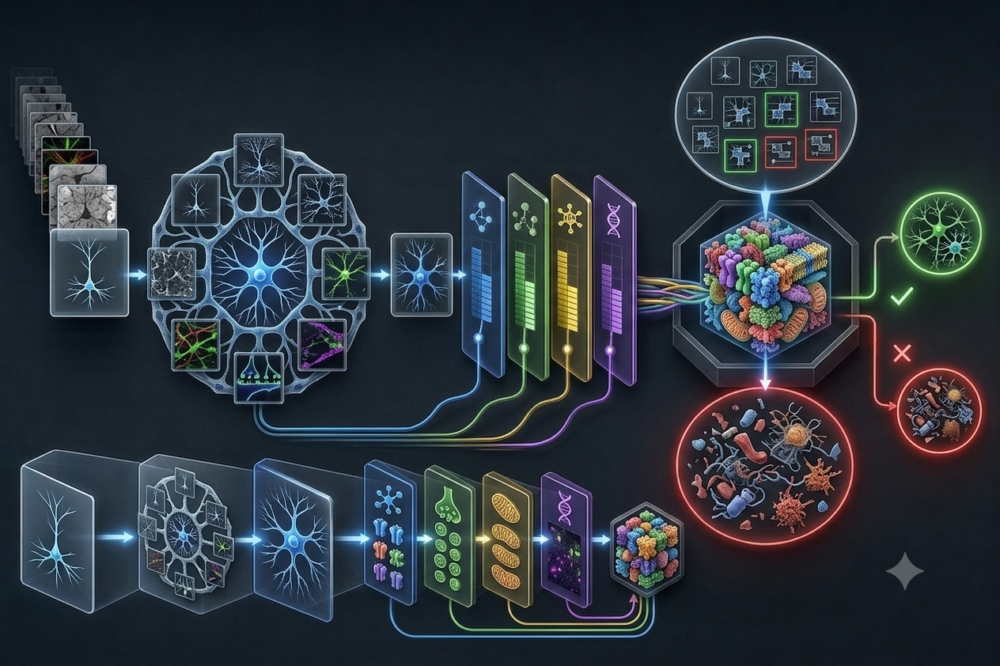

# Plexus: Design



*A symmetry-routed exact classifier — how it resolves a shape to a label.*

---

## 0. The task

The input is a **binary grid** (an `int[]` of `rows × cols` cells, each 0 or 1 — square by default, `side²`). Each grid carries a label: **1 if it belongs to a target shape class, 0 otherwise**. The class is defined by *structure under symmetry* — a shape and all of its rotations/reflections form one class — so the positives are typically a handful of symmetry orbits in a sea of negatives.

The hard case is **contradictions**: grids labelled *against their own symmetry orbit*. Two shapes can be identical under every symmetry-derived quantity yet carry opposite labels (e.g. one member of an orbit flipped to 0 while its orbit-mates stay 1, or a shape labelled 1 while its rotated copies stay 0). No symmetry quantity can separate such a pair — they are the crux the design must handle honestly rather than smooth over.

**The domain frame is read, not assumed.** `cli.Main` takes `rows × cols` off the data's `nxm` header ([§8](09-api.md)) and picks the group to match: **square** domains route under D4, **rectangular** (non-square) ones under D2, the transpose-free subgroup ([§2](04-symmetry.md); [§11](appendices/A-mathematical-background.md), *the rectangle*). The routing core — descriptor, context, score, topology — handles both, and so does whole-grid rendering (`Report.renderGrid` reads the true `rows × cols` off the Plexus). Where a report cannot follow, it says so rather than printing a misleading zero: `[b] SymmetrySlice` announces that regeneration is unavailable on a rectangular domain.

> *Reference datasets (`data/`, one slice-question each — see `data/README.md`): minimal by construction. Each carries only the positive class, plus — for the collision sets — the few negatives that share a context with a positive; the router defaults every unseen key to reject, so the sea of negatives is redundant. The canonical example is the T-tetromino orbit on a 3×3 grid (`conservation-t-orbit-3x3`), with adversarial variants injecting the contradictions above (`twin-t-flip`, `position-corner-dot`). Useful as concrete examples; nothing in the core depends on these numbers.*

---

## 1. What it is

`Plexus` is a *router*, not a network. It has no learned weights, no gates, no thresholds, no statistics. Every input is **resolved to a context** by pure structural routing, and the context returns its label.

```
score(grid):  grid  ──descriptor──▶  Key  ──▶  Context  ──▶  label
```

Two phases:

1. **Resolve** — build a composite routing `Key` from the grid: a *symmetry verdict* refined by a chain of *orthogonal, symmetry-invariant coordinates*.
2. **Decide** — the `Context` the key addresses owns its answer: its **majority label**, overridden by an **exact set of exceptions** (the grids whose label contradicts that majority).

Resolution is exact and discrete; the only memory is the set of contradicting grids, and self-extension ([§5](02-core-model.md)) drives even that down to the irreducible twins.
